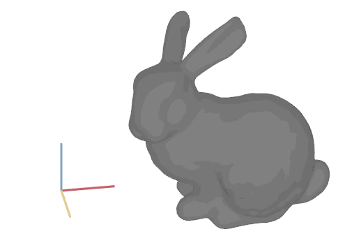

[](https://crates.io/crates/bevy-axes-gizmo)

# bevy-axes-gizmo



A tiny [Bevy](https://bevyengine.org) plugin that renders the X, Y and Z axes to a texture, following the orientation of your camera.

## Usage

```rust
App::new()
    .add_plugins(AxesGizmoPlugin::default())
```

- Add `AxesGizmoSyncCamera` to the camera the gizmo should follow.
- Read the rendered texture from the `AxesGizmoTexture` resource and show it in your UI (e.g. with an `ImageNode`).
- Colors, axis length/width and render layer are fields on `AxesGizmoPlugin`. Colors can be changed at runtime through the `AxesGizmoColors` resource.

See [`examples/basic.rs`](examples/basic.rs) for a full example:

```sh
cargo run --example basic
```

## Versions

The version matches Bevy's: use `bevy-axes-gizmo 0.X` with `bevy 0.X` (0.16 and up).
